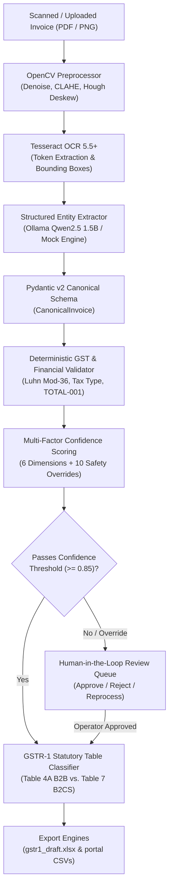

# GST Invoice Processing — Backend API & Validation Engine

[](https://www.python.org/)
[](https://fastapi.tiangolo.com/)
[](https://docs.pydantic.dev/)
[](https://github.com/tesseract-ocr/tesseract)
[](https://opencv.org/)
[](https://ollama.com/)
[](https://www.docker.com/)
[](https://docs.pytest.org/)

> **Statutory Notice:**  
> This software is an **academic prototype and automated draft preparation assistant**. It **does not file returns autonomously with the Goods and Services Tax Network (GSTN)** and does not provide legal or financial tax advisory. All generated GSTR-1 drafts must undergo mandatory verification by an authorized signatory before portal upload.

---

## Related Repositories & Live Services

| Component | Description | Link |
| :--- | :--- | :--- |
| **Complete System** | Full-stack monorepo with backend, frontend, docs, and benchmarks | [](https://github.com/srirampaila/gst-invoice-processing-system) |
| **Frontend UI** | React 18 + TypeScript + Vite + Tailwind CSS SPA | [](https://github.com/srirampaila/gst-invoice-processing-frontend) |
| **Backend API** | FastAPI + Tesseract + Ollama + Deterministic Engine *(This Repo)* | [](https://github.com/srirampaila/gst-invoice-processing-backend) |
| **Live Web App** | Production frontend deployed on Vercel | [](https://micro-gst-saas-ivzvy9erb-sriram-paila.vercel.app) |

---

## Architectural Overview

This repository contains the standalone **FastAPI backend, document intelligence pipeline, and deterministic financial validation engine** for the GST Invoice Processing system.

### Core Architectural Principle: Hybrid Deterministic-Generative Pipeline
1. **Generative LLMs (`Qwen2.5 1.5B`)** are restricted strictly to **unstructured semantic parsing** (identifying field labels, mapping noisy OCR tokens to schema attributes).
2. **Pure Python (`decimal.Decimal`)** retains **100% authoritative control** over all financial calculations, tax rate additions, Luhn checksums, and reconciliation rules.
3. **LLMs are never permitted to compute taxes or round totals.** Any floating-point drift or arithmetic hallucination is caught and rejected by deterministic validator gates.



---

## Key Modules & Pipeline Stages

### 1. Computer Vision Preprocessor (`src/preprocessing/`)
- **Bilateral Filtering:** Smooths surface noise while preserving high-contrast text edge gradients.
- **CLAHE:** Enhances local contrast in low-light camera photos and thermal receipts.
- **Hough Transform Deskewing:** Automatically corrects document rotational skew within $\pm 45^\circ$.
- **Adaptive Thresholding:** Binarizes documents for clean character boundary segmentation.

### 2. Optical Character Recognition (`src/ocr/`)
- Powered by **Tesseract OCR 5.5+** via `pytesseract`.
- Extracts raw text tokens, line bounding boxes, and per-word OCR confidence distributions.

### 3. Structured Entity Extraction (`src/extraction/`)
- Employs **Ollama Qwen2.5 1.5B** or deterministic mock extractors.
- Enforces strict Pydantic v2 validation against the `CanonicalInvoice` schema:
  - Seller and Buyer entities (Name, Address, GSTIN, State Code)
  - Invoice metadata (Number, Date, Supply Type: Inter-state vs Intra-state)
  - Line items (Description, HSN/SAC, Quantity, Unit Price, Taxable Amount, Tax Rate)
  - Tax summaries (CGST, SGST, IGST, Total Tax, Invoice Grand Total)

### 4. Deterministic GST Validation Engine (`src/validator/` & `src/validation/`)
- **`GSTIN-001` & `GSTIN-002`:** Validates 15-character GSTIN structure, state code (01–38, 97, 99), and offline **Luhn Modulo-36 checksum algorithm**.
- **`TAX-001`:** Statutory tax consistency check:
  - Intra-state (Supplier State $=$ Buyer State): Requires equal CGST and SGST ($CGST = SGST$). IGST must be zero.
  - Inter-state (Supplier State $\ne$ Buyer State): Requires IGST only. CGST and SGST must be zero.
- **`ARITH-001` & `ARITH-002`:** Line-item arithmetic verification:
  $$\text{Taxable Value} = \text{Quantity} \times \text{Unit Price} \pm ₹0.02$$
- **`TOTAL-001` (Mandatory Reconciliation Gate):**
  $$\left| \sum (\text{Taxable Values}) + \sum (\text{Taxes}) - \text{Invoice Grand Total} \right| \le ₹0.05$$

### 5. Multi-Factor Confidence Scoring (`src/confidence/`)
Weighted scoring across 6 dimensions:
- OCR character confidence (15%)
- Field completeness (25%)
- GSTIN syntactic & checksum validity (20%)
- Arithmetic exactness (20%)
- Tax rule consistency (10%)
- Date plausibility (10%)
**Safety Overrides:** 10 hard rules (e.g. `TOTAL-001` failure, invalid GSTIN) that immediately quarantine an invoice into the Human Review Queue regardless of overall score.

### 6. GSTR-1 Generator & Exporters (`src/gst/` & `src/export/`)
- **Table 4A (B2B):** Invoices with registered buyer GSTINs eligible for Input Tax Credit.
- **Table 7 (B2CS):** Consumer and unregistered buyer invoices aggregated by Place of Supply and tax rate.
- Multi-format exports: multi-sheet Excel workbook (`gstr1_draft.xlsx`) and portal-compatible CSV files.

---

## API Reference & Endpoints

FastAPI automatically generates interactive OpenAPI documentation at `/docs` (Swagger UI) and `/redoc` (ReDoc).

| Method | Endpoint | Description |
| :--- | :--- | :--- |
| `GET` | `/api/health` | Service liveness probe and dependency diagnostics |
| `POST` | `/api/invoices/process` | Upload invoice (file or sample ID) and execute full pipeline |
| `POST` | `/api/invoices/validate` | Run deterministic validator on canonical JSON payload |
| `GET` | `/api/invoices/list` | List processed invoices and metadata |
| `GET` | `/api/reviews/queue` | Retrieve invoices awaiting human-in-the-loop operator review |
| `POST` | `/api/reviews/action` | Submit reviewer action (`APPROVE`, `REJECT`, `REPROCESS`) |
| `GET` | `/api/gstr1/draft` | Retrieve categorized GSTR-1 Table 4A & Table 7 draft data |
| `GET` | `/api/gstr1/export/excel` | Download generated multi-sheet `gstr1_draft.xlsx` |
| `GET` | `/api/gstr1/export/csv` | Download portal-compatible GSTR-1 CSV archive |
| `GET` | `/api/system/diagnostics` | System resource utilization, Ollama status, and storage telemetry |

---

## Directory Structure

```
gst-invoice-processing-backend/
├── Dockerfile                   # Multi-stage production container image
├── docker-compose.yml           # Compose specification with Ollama service
├── requirements.txt             # Pinned production Python dependencies
├── .env.example                 # Configuration template with CORS & Ollama settings
├── .dockerignore                # Docker build context exclusions
├── .gitignore                   # Git exclusions (caches, .env, raw data)
├── app/
│   └── dashboard.py             # Streamlit fallback application
├── src/
│   ├── api/                     # FastAPI application, routers & lifespan handler
│   │   ├── app.py               # Application entrypoint & CORS middleware
│   │   ├── models.py            # API request/response schemas
│   │   └── routers/             # Endpoints (invoices, reviews, gstr1, system)
│   ├── confidence/              # Multi-factor scoring engine & safety overrides
│   ├── export/                  # Excel (.xlsx) and CSV statutory exporters
│   ├── extraction/              # Structured LLM/mock parser & CanonicalInvoice
│   ├── gst/                     # GSTR-1 table routing & statutory models
│   ├── ocr/                     # Tesseract engine & token bounding extractor
│   ├── preprocessing/           # OpenCV image cleanup (CLAHE, deskew, denoise)
│   ├── utils/                   # Paths, logging, and startup configuration validator
│   └── validation/              # Deterministic arithmetic & GSTIN Luhn checks
└── tests/                       # Automated test suites (unit, integration, regression)
    ├── test_api.py              # FastAPI endpoint tests (CORS, 404s, health)
    ├── test_validation.py       # Luhn Mod-36, arithmetic & statutory rule tests
    ├── test_confidence.py       # Multi-factor scoring & override trigger tests
    ├── test_gstr1.py            # GSTR-1 Table 4A / Table 7 routing tests
    ├── test_ocr.py              # OCR extraction tests
    ├── test_preprocessing.py    # Vision pipeline tests
    └── ...
```

---

## Prerequisites

- **Python:** `3.12` recommended (compatible with 3.10+)
- **Tesseract OCR:** `5.0+`
  - macOS: `brew install tesseract`
  - Ubuntu/Debian: `sudo apt-get install tesseract-ocr tesseract-ocr-eng libtesseract-dev`
- **Ollama (Optional for local LLM inference):**
  - Install from [ollama.com](https://ollama.com/)
  - Pull model: `ollama pull qwen2.5:1.5b`
  - *(Note: If Ollama is offline or unavailable, the backend automatically uses deterministic mock extraction without failing.)*

---

## Installation & Local Execution

### 1. Clone the Repository
```bash
git clone https://github.com/srirampaila/gst-invoice-processing-backend.git
cd gst-invoice-processing-backend
```

### 2. Create Virtual Environment
```bash
python3.12 -m venv .venv
source .venv/bin/activate
```

### 3. Install Dependencies
```bash
pip install --upgrade pip
pip install -r requirements.txt
```

### 4. Configure Environment
```bash
cp .env.example .env
```
Default configuration:
```env
HOST=127.0.0.1
PORT=8000
CORS_ORIGINS=http://localhost:5173,https://micro-gst-saas-ivzvy9erb-sriram-paila.vercel.app
OLLAMA_BASE_URL=http://127.0.0.1:11434
DATA_DIR=data
```

### 5. Start the FastAPI Server
```bash
uvicorn src.api.app:app --host 127.0.0.1 --port 8000 --reload
```
The API is live at:
- **API Root:** `http://127.0.0.1:8000`
- **Swagger Documentation:** `http://127.0.0.1:8000/docs`
- **Health Check:** `http://127.0.0.1:8000/api/health`

### 6. Optional: Run Streamlit Fallback Dashboard
```bash
streamlit run app/dashboard.py
```

---

## Docker & Cloud Deployment

### 1. Run with Docker
```bash
# Build Docker image
docker build -t gst-backend:latest .

# Run container
docker run -d -p 8000:8000 \
  -e CORS_ORIGINS="http://localhost:5173,https://micro-gst-saas-ivzvy9erb-sriram-paila.vercel.app" \
  gst-backend:latest
```

### 2. Run with Docker Compose (Backend + Ollama)
```bash
docker-compose up -d
```

### 3. Deploy to Render / Railway / Fly.io
1. Connect the `srirampaila/gst-invoice-processing-backend` GitHub repository.
2. Select **Dockerfile** as the build runtime.
3. Configure Environment Variables:
   - `PORT=8000`
   - `CORS_ORIGINS=https://micro-gst-saas-ivzvy9erb-sriram-paila.vercel.app`
4. Set Health Check path: `/api/health`.

---

## Automated Testing

Run the automated test suite with pytest:
```bash
pytest tests/ -v -k "not test_e2e_comprehensive"
```
**Current Test Coverage:**
- **121 unit & integration tests passing** with 0 regressions.
- Validates Luhn Mod-36 checksum, decimal rounding, tax consistency, and GSTR-1 routing.

---

## License & Attribution

- **License:** Educational and Academic Research License.
- **Author:** Sriram Paila ([@srirampaila](https://github.com/srirampaila))
